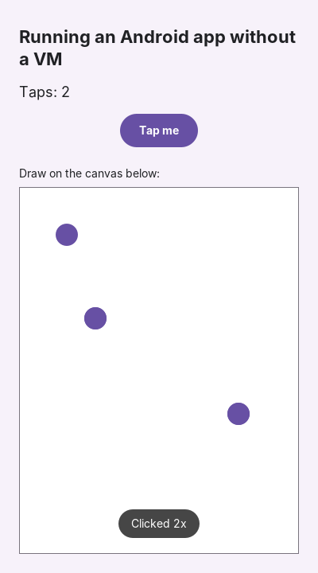

# Apk-Runner

Inspect, unpack and run Android apps (APK, XAPK, APKM) on **Windows, Intel Macs,
Apple Silicon Macs and Linux**, from one small tool with no dependencies.

The tool is pure Python, with no packages to install (it's about 30 KB). It picks the
best way to run each app on your machine:

| Your computer | How apps run | VM? |
|---|---|---|
| Apple Silicon Mac + [Mac.apk](https://github.com/kksimp/Mac.apk) installed | Natively through Mac.apk | **No** |
| Intel Mac | Android emulator (hardware-accelerated) + scrcpy window | Yes, a lightweight one |
| Windows 10/11 | Android emulator (WHPX acceleration) + scrcpy window | Yes, a lightweight one |
| Linux | Android emulator (KVM) + scrcpy window | Yes, a lightweight one |
| **Any OS + Java 11+** | **Apk-Runner's own Android framework on Java** (`--backend java`), *experimental* | **No** |

> **Why a VM on Intel and Windows?** Most apps, games especially, include native ARM
> code. Apple Silicon is ARM, so Mac.apk runs that code directly. Intel and AMD CPUs
> can't, so ARM code has to be translated, and today only Android system images ship
> that translator. A VM-free x86 runtime is on the [roadmap](#roadmap). Run
> `apkrunner inspect` to see which apps could run without one.

---

## 1. Install

Download the file for your computer from the [Releases page](../../releases/latest).
You don't need Python.

| Computer | File | How to install |
|---|---|---|
| Windows 10/11 (64-bit) | `apkrunner-windows-x64.exe` | Put it in a folder (e.g. `C:\apkrunner`), and run it from Command Prompt or PowerShell |
| Intel Mac | `apkrunner-macos-intel.dmg` | Open the dmg, copy `apkrunner` to `/usr/local/bin` |
| Apple Silicon Mac (M1–M4) | `apkrunner-macos-apple-silicon.dmg` | Same as Intel |
| Linux x64 | `apkrunner-linux-x64` | `chmod +x apkrunner-linux-x64` |

It's a command-line tool: open a terminal in its folder and type commands like
`apkrunner run app.apk` (Windows: `apkrunner-windows-x64.exe run app.apk`).

**macOS "unidentified developer" warning:** the binary isn't notarized yet. Allow it once:
```bash
xattr -d com.apple.quarantine /usr/local/bin/apkrunner
```
**Windows SmartScreen:** click *More info* → *Run anyway*.

**From source (developers):** `git clone https://github.com/gyuv/Apk-Runner && cd Apk-Runner && python -m apkrunner --help`

## 2. Set up a backend to run apps

Check what's available on your machine:

```bash
apkrunner doctor
```

### Apple Silicon Mac (no VM)
Install Mac.apk from its [releases](https://github.com/kksimp/Mac.apk/releases/latest)
into `/Applications`. Then `apkrunner run app.apk` uses it automatically.

### Intel Mac, Windows, Linux (or Apple Silicon without Mac.apk)
1. Install the **Android command-line tools** from
   [developer.android.com/studio](https://developer.android.com/studio#command-line-tools-only)
   (no need for the full Android Studio). Unzip them to
   `<SDK>/cmdline-tools/latest/`, then set `ANDROID_HOME=<SDK>`.
2. Install the emulator, adb and a system image. Use the x86_64 image on Intel/AMD and
   the arm64 image on Apple Silicon. The x86_64 Android 11+ images include ARM
   translation, so ARM-only apps work too:
   ```bash
   sdkmanager "platform-tools" "emulator" "system-images;android-34;google_apis;x86_64"
   avdmanager create avd -n apkrunner -k "system-images;android-34;google_apis;x86_64" -d pixel_6
   ```
3. Turn on hardware acceleration:
   - **Windows:** *Turn Windows features on or off* → enable **Windows Hypervisor Platform**, then reboot.
   - **Intel Mac:** built in (Hypervisor.framework), nothing to do.
   - **Linux:** make sure `/dev/kvm` exists (`sudo apt install qemu-kvm` and add yourself to the `kvm` group).
4. (Recommended) Install **[scrcpy](https://github.com/Genymobile/scrcpy)** so each app
   opens in its own desktop window. Use `brew install scrcpy`, `winget install Genymobile.scrcpy`
   or `apt install scrcpy`.

## 3. Use it

```bash
apkrunner run game.apk               # boot (lite profile), install, launch, open window
apkrunner run app.xapk               # split bundles are installed with all their parts
apkrunner run app.apk --avd apkrunner --full   # choose the AVD, use full resources
apkrunner inspect app.apk            # can it run natively on this machine?
apkrunner inspect --json app.apk     # machine-readable output
apkrunner extract app.apk -o out/    # unpack and decode AndroidManifest.xml to readable XML
apkrunner merge app.xapk -o splits/  # pull the split APKs out of a bundle
apkrunner apis app.apk               # which Android framework classes the app uses most
apkrunner convert app.apk -o app.jar # app code (DEX) -> standard Java .jar (needs Java 8+)
```

`convert` downloads [dex2jar](https://github.com/pxb1988/dex2jar) (Apache-2.0) once,
into `~/.apkrunner/tools`.

`run` options:

| Option | Meaning |
|---|---|
| `--backend macapk\|emulator` | Force a backend |
| `--avd NAME` | Which emulator to boot (default: first one found) |
| `--full` | Turn off the lite profile (lite = 2 GB RAM, no audio, no boot animation) |
| `--no-window` | Don't open scrcpy; just install and launch |

An emulator that's already running (or a real phone connected over USB) is reused,
so the second launch takes a few seconds.

### What `inspect` tells you

| Verdict | Meaning |
|---|---|
| `native` | No native code, or native code for your CPU: runnable without translation |
| `needs-translation` | ARM-only native code on an Intel/AMD machine |
| `unsupported` | No native code for any CPU type your machine can run |

## 3b. The VM-free Java backend (experimental)

Apk-Runner includes its own implementation of Android's app framework, written in Java.
An app's code is converted from DEX to Java bytecode and runs directly on your
computer's Java runtime, in its own desktop window. There's no emulator, no VM and no
Android system underneath, and it works the same on Windows, Intel Macs, Apple Silicon
Macs and Linux.

```bash
apkrunner run samples/hello/hello.apk --backend java
```



Requirements: **Java 11 or newer** ([Adoptium](https://adoptium.net/) is free).
Press `Esc` for Android's Back button.

**What works today:** `Activity` lifecycle, `setContentView` with views built in code,
`View`, `ViewGroup`, `LinearLayout` (including weights), `FrameLayout`, `TextView`,
`Button`, `Toast`, custom views with `onDraw` (`Canvas` and `Paint`: rects, circles,
ovals, lines, text), touch and click events, `Handler`/`postDelayed`, `Bundle`,
`Intent` (starting activities), `Log`, `Build`, `Color`, `DisplayMetrics`.

**Not yet:** XML layouts and `resources.arsc` (so `R.layout`/`R.string` don't work
yet), images, `EditText`/keyboard input, scrolling, `RecyclerView`, services, OpenGL,
sound, and native `.so` libraries. Most store apps use some of these, so for now they
fail with a clear message naming the missing Android class, for example:

```
This app needs the Android class android.content.ServiceConnection, which Apk-Runner does not implement yet.
```

To see what an app needs, run `apkrunner apis app.apk`.

**Testing without a window:** `--screenshot out.png` renders the app to an image, and
`--tap X,Y` (repeatable) taps the screen first. This is what CI uses.

## 4. Troubleshooting

| Problem | Fix |
|---|---|
| `No backend available` | Install the emulator (step 2), or set `ANDROID_HOME` |
| `No AVD found` | Run the `avdmanager create avd ...` line from step 2 |
| Emulator very slow | Hardware acceleration is off (step 2.3) |
| `INSTALL_FAILED_NO_MATCHING_ABIS` | Use an Android 11+ x86_64 image (it has ARM translation) |
| App opens but no window appears | Install scrcpy, or open the emulator window |

## Roadmap

1. Inspector, unpacker, bundle merge, multi-backend runner. **(done, v0.2)**
2. Java-only apps without a VM:
   - DEX reader and framework API usage report (`apis`). **(done, v0.3)**
   - DEX → JVM `.jar` conversion (`convert`). **(done, v0.3)**
   - Android framework core on Java: Activity, View, layouts, Canvas, touch, Toast, desktop window. **(done, v0.4)**
   - Resources: binary XML layouts, `resources.arsc`, `R.*` IDs, images. *(next)*
   - `EditText` and keyboard input, scrolling, `RecyclerView`, `SharedPreferences`, SQLite.
3. Native x86_64 `.so` loading without a VM (ELF loader + bionic shim), with GLES through ANGLE.
4. ARM → x86 translation, so ARM-only apps run without a VM on Intel and Windows.

Steps 2–4 are a large research effort (Mac.apk itself is about 3,000 files). Contributions are welcome.

## Developing

```bash
python -m unittest discover -s tests -t .   # tests (the Java backend test needs a JDK)
python scripts/build_sample.py              # rebuild samples/hello/hello.apk
pip install pyinstaller && pyinstaller --onefile --name apkrunner --paths . scripts/apkrunner_entry.py
```

To publish a release, push a tag (`git tag v0.2.0 && git push origin v0.2.0`) or run
the **Release** workflow from the Actions tab. It builds the Windows `.exe`, the two
macOS `.dmg` files and the Linux binary on GitHub's machines and attaches them.

## License

Written from scratch. It doesn't contain code from Mac.apk (AGPL-3.0), which it only
launches as a separate program when that's installed.
